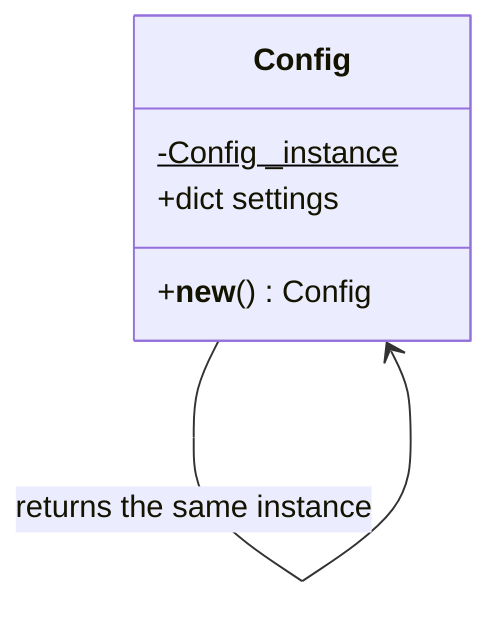
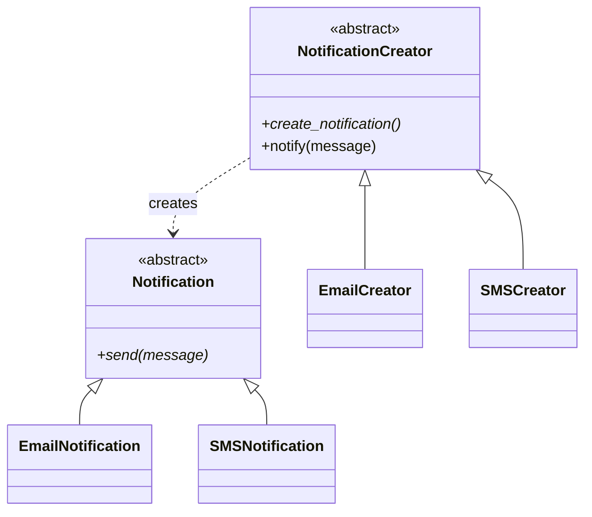
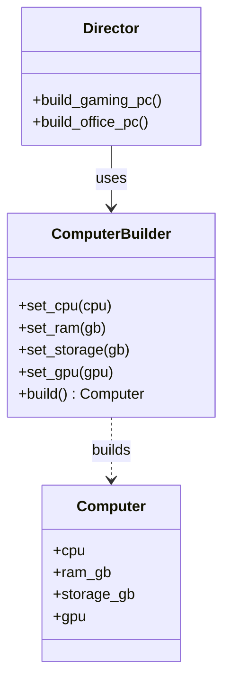
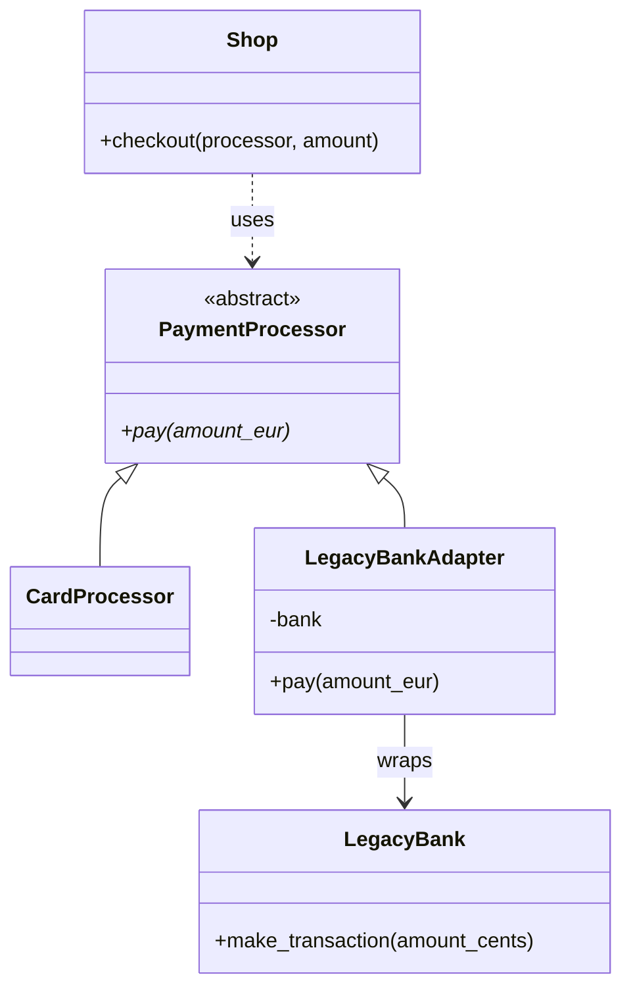
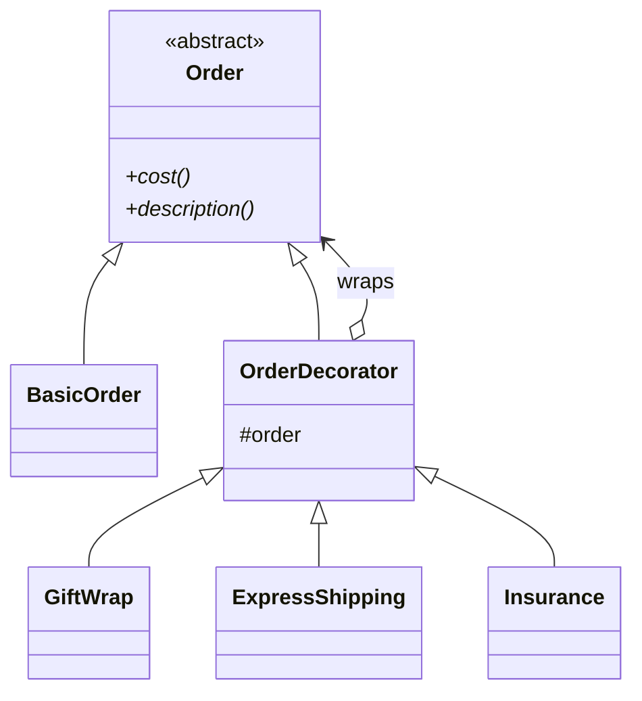
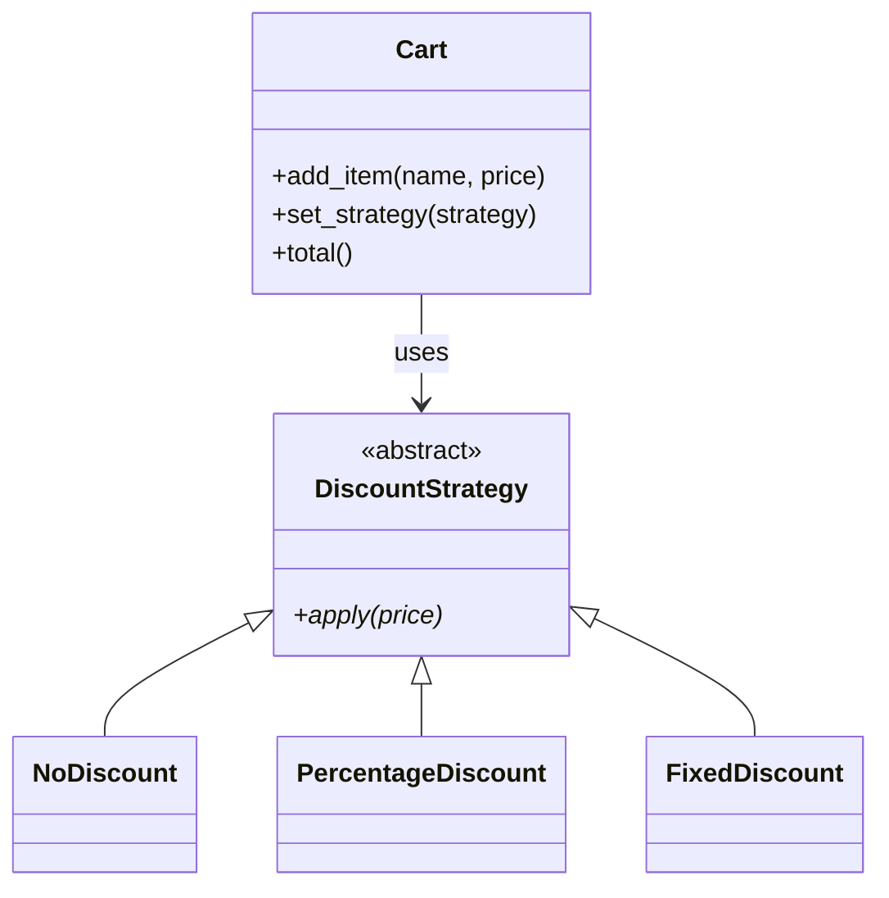
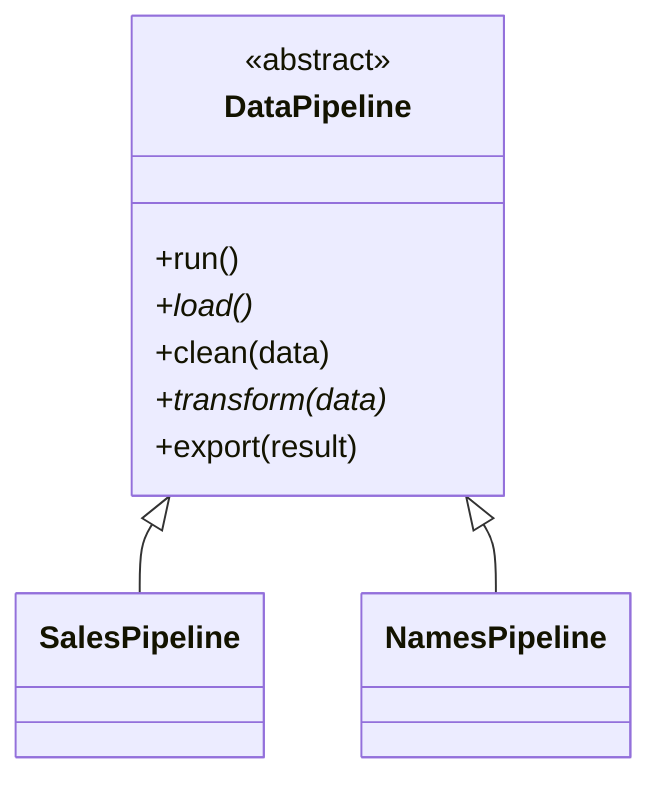

# Design patterns in Python

Seven patterns from the course, grouped in the three families. Each file has a small example and a demo at the bottom.

| Family | File | Patterns |
|---|---|---|
| Creational | `creational_patterns.py` | Singleton, Factory Method, Builder |
| Structural | `structural_patterns.py` | Adapter, Decorator |
| Behavioral | `behavioral_patterns.py` | Strategy, Template Method |

Run a file with `python creational_patterns.py` (same for the two others).

Following the course advice, each pattern is drawn before the code.

## Creational patterns

### Singleton: one shared configuration
Problem: the whole app needs one single configuration object.
Solution: `__new__` returns the same instance every time.

### Factory Method: notifications
Problem: the type of notification (email, SMS) changes, the sending code should not.
Solution: the creator calls an abstract `create_notification()`, and each subclass chooses the product.

### Builder: computers
Problem: a computer has many optional parts, so a constructor with many arguments is hard to read.
Solution: a builder sets the parts step by step, and a director holds the common recipes.

## Structural patterns

### Adapter: legacy bank
Problem: the shop expects `pay(amount_eur)`, but the old bank class offers `make_transaction(amount_cents)` and cannot be changed.
Solution: an adapter implements the expected interface and translates the call.

### Decorator: order options
Problem: gift wrap, express shipping and insurance can be combined in any way.
Solution: each option wraps an order and has the same interface, so options can be stacked.

## Behavioral patterns

### Strategy: discounts
Problem: an `if/elif` chain on the discount type is hard to extend.
Solution: each discount is a class with `apply()`, and the cart can switch strategy at runtime.

### Template Method: data pipelines
Problem: several pipelines follow the same steps (load, clean, transform, export), only some steps change.
Solution: `run()` in the superclass fixes the order, subclasses override the steps.

